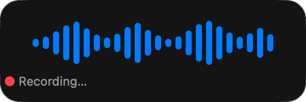

# WhisperHotkey

**Hold a shortcut. Speak. Release to type.**

WhisperHotkey is a native macOS menu-bar app that turns your voice into text in
other apps using [whisper.cpp](https://github.com/ggml-org/whisper.cpp). It runs
transcription on your Mac, pastes into the focused text field, and gives you a
short countdown before pressing the app’s submit shortcut.

No account, API key, or cloud transcription service is required. Once the model
is downloaded, dictation works offline.

<p align="center">
  
</p>

<p align="center"><em>The actual recording overlay on macOS, captured with a sample waveform for this preview.</em></p>

## Features

- **Hold-to-dictate anywhere you can paste.** The default shortcut is
  **Control + Option + Command + R** (`⌃⌥⌘R`); change it in settings.
- **Local speech recognition.** Audio goes to a whisper-server bound to
  `127.0.0.1`, with whisper-cli as a fallback.
- **A model that stays ready.** A resident server avoids loading the model for
  every dictation; an idle warm-up runs alongside recording to reduce delays.
- **Live waveform and transcription status.** A floating overlay shows when
  you’re recording and when recognition is running. macOS 26 adds Liquid Glass.
- **Time to review before sending.** The countdown adapts to transcript length:
  3 seconds for up to 8 words, 4 for up to 25, and 5 for longer text by default.
- **Per-app submit shortcuts.** Use Enter in one app and Command + Enter in
  another. Press Esc, click the countdown, or start typing to cancel submission.
- **Focus protection.** If you switch apps while dictating, the default behavior
  leaves the transcript on the clipboard instead of pasting into the new app.
- **Language controls.** Use automatic detection, pin a set of likely languages,
  or force your primary language for a single recognition pass.
- **Editable settings without a restart.** Customize the hotkey, countdown,
  appearance, model, language preferences, and text formatting; choose
  **Reload config** from the menu bar.
- **Start at login.** Setup installs a per-user LaunchAgent. The menu-bar menu
  lets you pause the hotkey, open settings and logs, or quit.

## Requirements

- A Mac with a microphone. Apple Silicon is recommended for local inference.
- A recent Xcode Command Line Tools installation with Swift and the macOS 26
  SDK to build the Liquid Glass code. Older macOS versions use a dark panel
  fallback; the app bundle declares macOS 13 as its minimum runtime version.
- [CMake](https://cmake.org/) to build whisper.cpp. If you use Homebrew:
  `brew install cmake`.
- Internet access during setup to fetch whisper.cpp and the model. The default
  `ggml-large-v3-turbo.bin` model download is approximately 1.6 GB; allow
  additional space and memory for the build and inference.

The source build is the installation method; there is no packaged release yet.

## Install

```sh
git clone https://github.com/ArthurianX/WhisperHotkey.git
cd WhisperHotkey
./setup.sh
./build.sh
```

`setup.sh` creates settings, builds whisper.cpp in `~/whisper.cpp`, downloads the
model, creates a local signing identity, and installs the login agent.
`build.sh` runs the tests, builds and signs `WhisperHotkey.app`, then launches it.
Keep the checkout in its installed location: the login agent points to that app.
If you move it, rerun setup to update the agent.

Setup may prompt for Keychain authorization. It is safe to rerun; existing
components are reused. To reuse a custom whisper.cpp installation or model:

```sh
WHISPER_ROOT="$HOME/whisper.cpp" WHISPER_HOTKEY_MODEL=ggml-large-v3-turbo.bin ./setup.sh
```

When using a custom location or model, also set `whisper.root` and
`whisper.model` in the app settings. Setup accepts `--skip-whisper`,
`--skip-model`, `--skip-agent`, and `--cert` (signing identity only).

### Grant macOS permissions

Open **System Settings → Privacy & Security** and enable WhisperHotkey under:

1. **Microphone**, so it can record while you hold the shortcut.
2. **Accessibility**, so it can paste text, send submit shortcuts, and cancel
   the countdown with keyboard events.

Without Accessibility permission, transcription is copied to the clipboard for
manual pasting. If the app is absent from a permission list, launch it and try
the hotkey, then check again.

### Local signing

Setup creates a self-signed identity named `WhisperHotkey Local Signing` in your
login Keychain. A stable signing identity helps preserve macOS permission grants
across rebuilds. Set `WHISPER_HOTKEY_SIGNING_IDENTITY` when running setup and
build if you want to use a different identity.

Private-key import files are created in an owner-only temporary directory and
removed on exit. Keys stay in Keychain; never commit signing keys or bundles.

## Use it

1. Focus a text field in your editor, chat app, or browser.
2. Hold **⌃⌥⌘R** and speak. The waveform follows your microphone level.
3. Release the shortcut. The overlay changes to **Transcribing…**.
4. Review the pasted text during the countdown. **Esc**, a click on the
   countdown, or typing cancels auto-submit; the pasted text stays available.
5. Let the countdown finish to send the configured submit shortcut.

The menu-bar waveform icon shows the current state and provides **Pause
hotkey**, **Reload config**, **Open settings**, **Open log folder**, and **Quit**.

> Auto-submit targets the app that is frontmost when the countdown ends.
> Cancel the countdown before switching apps if you don’t want to send a key
> there. For chat apps that send on a newline, enable `text.joinSegments` so
> multi-line recognition results are pasted as a single line.

## Configuration

Choose **Open settings** from the menu bar. Normally settings live at
`~/.config/whisper-hotkey/config.json`. After editing, choose **Reload config**.
See [config.json.example](config.json.example) for a complete example.

Settings are resolved in this order:

1. The file specified by `WHISPER_HOTKEY_CONFIG`.
2. `~/.config/whisper-hotkey/config.json`, if present.
3. An ignored `config.json` in the checkout, if present.
4. Built-in defaults, written to the normal settings path on first run.

A small settings file can override just the options you need:

```json
{
  "hotkey": { "key": "r", "modifiers": ["cmd", "opt", "ctrl"] },
  "submitKeys": {
    "default": "enter",
    "com.tinyspeck.slackmacgap": "cmd+enter"
  },
  "text": { "joinSegments": true },
  "pinnedLanguages": ["ro", "en"],
  "forcePrimaryLanguage": false
}
```

Omitted options retain their built-in defaults. The example file includes
Romanian/English pinning and a Slack shortcut; built-in defaults use automatic
language detection and Enter for every app.

| Setting | Purpose |
| --- | --- |
| `hotkey.key`, `hotkey.modifiers` | Hold-to-record shortcut |
| `countdown` | Word-count thresholds and short, medium, long durations |
| `submitKeys` | App bundle ID → shortcut; `default` covers unmapped apps |
| `messages.titleFormat`, `messages.cancelHint` | Countdown text; title supports `{seconds}` and `{key}` |
| `glass` | Style, size, corner radius, optional tint and waveform/progress color |
| `whisper.root`, `whisper.model` | whisper.cpp directory and model filename under its `models/` directory |
| `server.enabled`, `server.port` | Resident local server; disabling it uses whisper-cli per dictation |
| `server.warmUpAfterSeconds` | Idle threshold for warm-up; `0` disables it |
| `pinnedLanguages` | Two or more likely language codes for server-side detection and retry |
| `forcePrimaryLanguage` | Force the first pinned language instead of detecting |
| `text.maxSegmentChars` | Segment length limit; `-1` removes the length cap |
| `text.joinSegments` | Merge recognized lines into one; off by default |
| `paste.requireUnchangedFocus` | Skip auto-paste if the focused app changed; on by default |
| `debug.overlayDiagnostics` | Enable detailed overlay troubleshooting logs |

Supported submit chords include `enter`, `cmd+enter`, `shift+enter`, and
`ctrl+opt+enter`. Missing settings use defaults; malformed JSON and supported
validation warnings are reported in the log.

## Privacy and local files

WhisperHotkey performs speech recognition locally. Setup downloads dependencies
and model weights; runtime transcription and warm-up requests use loopback HTTP
only. No hosted transcription account or API credential is needed.

| Location | Contents |
| --- | --- |
| `~/.config/whisper-hotkey/config.json` | Personal settings |
| `~/Library/Caches/whisper-hotkey/` | App/server logs, temporary audio and CLI transcript files |
| `~/Library/LaunchAgents/com.arthur.whisper-hotkey.plist` | Login agent |
| `~/whisper.cpp/` | Default inference binaries and model weights |
| macOS login Keychain | Local code-signing identity |

Temporary dictation files are cleaned up after transcription; a crash can leave
files in the cache directory. The transcript is placed on the system clipboard
and pasted into your chosen app, which handles it under its own privacy rules.
Inspect logs before sharing them: paths and app identifiers can be personal.
Personal settings, recordings, logs, and signing-key files are ignored by Git.

## Troubleshooting

| Symptom | What to check |
| --- | --- |
| Nothing happens on the shortcut | Check that the hotkey is not paused, microphone access is enabled, and another app does not own the shortcut. Registration failures appear in the log. |
| Text reaches the clipboard but isn’t pasted | Enable Accessibility permission for the signed app. |
| Paste is skipped after switching apps | Focus protection is working; paste manually or change `paste.requireUnchangedFocus`. |
| Line breaks send a chat message early | Set `text.joinSegments: true` and reload config. |
| Incorrect language | Set `pinnedLanguages`, or enable `forcePrimaryLanguage` with your preferred language first. |
| Slow first dictation after idle | Keep the resident server enabled and review `server.warmUpAfterSeconds`; actual speed depends on hardware and model size. |
| Overlay is missing | Enable `debug.overlayDiagnostics`, reproduce, and inspect the app log. An intermittent visibility issue after long uptime remains under investigation. |
| Build cannot find a signing identity | Run `./setup.sh --cert`, or set `WHISPER_HOTKEY_SIGNING_IDENTITY` to an identity in your Keychain. |

Language-probability pinning needs whisper-server; the CLI fallback supports
forcing the primary language but cannot compare per-language probabilities.
Overlays currently use the main screen.

## Development

```sh
./test.sh                 # Compile and run the test suite
swiftc -typecheck *.swift # Type-check all app sources
./build.sh                # Test, compile, sign, and restart the app
```

GitHub Actions runs tests and type-checking on pushes and pull requests.

| Files | Responsibility |
| --- | --- |
| `AppBootstrap.swift`, `main.swift` | App startup, permissions, and wiring |
| `WhisperController.swift` | Recording → transcription → paste → submit |
| `WhisperServer.swift`, `Transcriber.swift`, `WarmUp.swift` | Local inference and warm-up |
| `RecordingOverlay.swift`, `CountdownOverlay.swift`, `OverlayPanel.swift` | Native overlays |
| `Config.swift`, `RuntimePaths.swift` | Settings and file locations |
| `HotKey.swift`, `SubmitChord.swift`, `TextInjector.swift`, `FocusGuard.swift` | Shortcuts, keystrokes, and focus checks |
| `StatusMenu.swift`, `Logger.swift` | Menu-bar controls and logging |
| `tests/` | Test runner and behavioral checks |

Historical design notes and implementation plans are in
[docs/superpowers](docs/superpowers).

## Contributing

Issues and pull requests are welcome. Include your macOS version, model,
reproduction steps, and relevant sanitized logs when reporting a bug. Run the
tests and type-check before submitting changes. Keep private settings, audio,
transcripts, signing keys, and other credentials out of commits and attachments.
